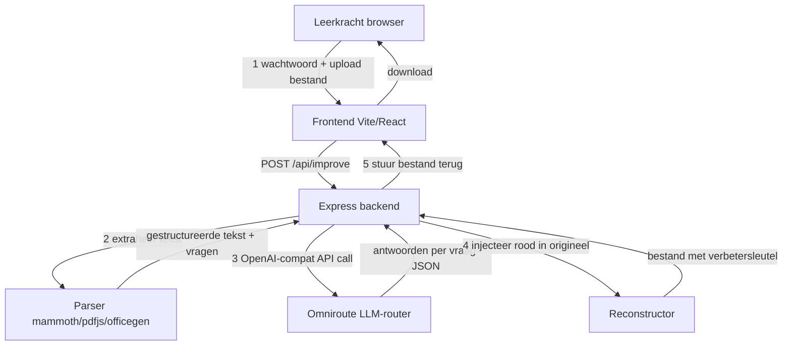

# Verbeterrobot — Technisch Plan

> **Doel:** Een zelfstandige webapp waarmee leerkrachten een taak- of toetsdocument uploaden,
> waarna AI (via Omniroute) de vragen oplost en het originele document teruggeeft met de
> verbetersleutel **in het rood bij de vragen ingevoegd** — zelfde bestandsformaat, ongewijzigde opmaak.

---

## Samenvatting van de vereisten

| Aspect | Keuze |
|---|---|
| Deployment | Standalone app (los van praktijkmatrix) |
| Authenticatie | Één gedeeld wachtwoord voor leerkrachten |
| Invoerformaten | .docx · .pdf · .pptx · .xlsx · .txt |
| Uitvoerformaat | Zelfde als invoer (originele opmaak bewaard) |
| Verbetersleutel | Antwoorden in **rood** ingevoegd **bij de vragen** (niet apart) |
| AI-backend | Omniroute (zelf-gehoste OpenAI-compatibele LLM-router) |
| Deployment | Docker Compose (standalone) |

---

## Architectuur



---

## Projectstructuur

```
verbeterrobot/
├── server/
│   ├── index.js          # Express server, auth, upload-route
│   ├── parser.js         # Tekst extractie per formaat
│   ├── ai.js             # Call naar Omniroute (OpenAI-compat)
│   └── injector.js       # Rode antwoorden injecteren in origineel document
├── src/
│   ├── main.tsx
│   ├── App.tsx           # Upload UI + wachtwoord
│   └── index.css
├── public/
├── .env.example
├── .env                  # (gitignored)
├── package.json
├── vite.config.ts
├── tsconfig.json
├── Dockerfile
└── docker-compose.yml
```

---

## Backend

### Authenticatie
- Eenvoudige middleware: request header `X-App-Password` of form-field `password` wordt vergeleken met `APP_PASSWORD` uit `.env` (bcrypt-hash of plaintext voor eenvoud).
- Geen sessies nodig — stateless per request.

### Upload & verwerkingsroute
```
POST /api/improve
  Content-Type: multipart/form-data
  Fields: password, file (max 20 MB)

Response: bestand (application/octet-stream) met Content-Disposition: attachment
```

### `server/parser.js` — tekst-extractie

| Formaat | Bibliotheek |
|---|---|
| `.docx` | `mammoth` → plain text + structuur |
| `.pdf` | `pdf-parse` |
| `.pptx` / `.xlsx` | `officeparser` of `xlsx` + `pptx2json` |
| `.txt` | rechtstreeks `fs.readFile` |

> **Principe:** De parser extraheert de volledige tekst en identificeert vragen via nummering (1. / a) / vraag:) of heuristiek.

### `server/ai.js` — Omniroute-integratie

```js
// OpenAI-compatibele call
POST ${OMNIROUTE_BASE_URL}/chat/completions
Authorization: Bearer ${OMNIROUTE_API_KEY}
{
  model: OMNIROUTE_MODEL,
  messages: [
    { role: "system", content: SYSTEM_PROMPT },
    { role: "user",   content: <geëxtraheerde documenttekst> }
  ]
}
```

**System prompt (kern):**
```
Je bent een ervaren leerkracht. Je krijgt een taak of toetsdocument.
Los alle vragen op. Geef als antwoord een JSON-array:
[{ "vraag": "<geciteerde vraag of nummer>", "antwoord": "<correct antwoord>" }, ...]
Wees beknopt en precies. Gebruik de taal van het document.
```

### `server/injector.js` — rode antwoorden injecteren

| Formaat | Aanpak |
|---|---|
| `.docx` | `docx` (npm) of `python-docx` via child_process: na elke paragraaf met een vraag wordt een nieuwe run toegevoegd in rood (`color: FF0000`) |
| `.pdf` | `pdf-lib`: tekstannotaties in rood toevoegen op de juiste positie |
| `.pptx` | XML-manipulatie via `jszip` + tekst-run in rood |
| `.xlsx` | `exceljs`: cel-commentaar of aparte rij in rood |
| `.txt` | Antwoord-regels in `[ANTWOORD: ...]`-formaat toevoegen |

> **Kritische beperking voor PDF:** PDF heeft een vaste layout. Antwoorden worden als **annotatie** (rode tekst-box) toegevoegd, niet inline in de tekst. De originele layout blijft 100% onaangetast. Voor `.docx` is inline injectie wél mogelijk zonder opmaakbreuk.

---

## Frontend

Eenvoudige single-page app (React + Tailwind):

1. **Wachtwoordscherm** — invoerveld + knop "Aanmelden"
2. **Uploadscherm** (na auth):
   - Drag-and-drop of bestandskiezer
   - Geselecteerd bestand zichtbaar (naam + grootte)
   - Optioneel: extra instructies/context voor de AI (tekstgebied)
   - Knop **"Verbeteren"**
3. **Verwerking**: voortgangsanimatie + stap-indicator (uploaden → analyseren → AI → genereren)
4. **Resultaat**: directe downloadknop voor het verbeterde document

---

## Configuratie (`.env.example`)

```env
# Gedeeld wachtwoord voor leerkrachten
APP_PASSWORD=changeme

# Omniroute (OpenAI-compatibel)
OMNIROUTE_BASE_URL=https://omniroute.example.com/v1
OMNIROUTE_API_KEY=
OMNIROUTE_MODEL=gpt-4o

# Server
PORT=3010
MAX_FILE_MB=20
```

---

## Docker Compose

```yaml
services:
  verbeterrobot:
    build: .
    ports:
      - "3010:3010"
    env_file: .env
    restart: unless-stopped
    volumes:
      - ./uploads:/app/uploads  # tijdelijke bestanden (worden na download verwijderd)
```

---

## Veiligheidsnota's

- Uploaded bestanden worden **onmiddellijk na verwerking verwijderd** van de server (geen persistentie).
- De `APP_PASSWORD` nooit hardcoden — altijd via `.env`.
- `OMNIROUTE_API_KEY` nooit in code of git opslaan.
- Bestandsgrootte beperken (standaard 20 MB) via multer.
- Bestandstype valideren op MIME-type én extensie (whitelist).

---

## Implementatiestappen (voor Code-modus)

1. **Projectopzet**: `verbeterrobot/` aanmaken, `package.json`, Vite + React + Express, TypeScript, Tailwind
2. **`.env.example`** aanmaken
3. **`server/index.js`**: Express server, multer-upload, wachtwoord-middleware
4. **`server/parser.js`**: tekst-extractie per formaat (mammoth, pdf-parse, officeparser)
5. **`server/ai.js`**: Omniroute API-call met gestructureerde prompt en JSON-response parsing
6. **`server/injector.js`**: antwoorden in rood injecteren per formaat
7. **Frontend `src/App.tsx`**: wachtwoordscherm + uploadflow + downloadknop
8. **`Dockerfile` + `docker-compose.yml`**: standalone deployment
9. **Testen** met elk bestandsformaat
10. **Plan bijwerken** en Memory opslaan

---

## Openstaande keuzes / risico's

| Punt | Risico | Mitigatie |
|---|---|---|
| PDF inline injectie | PDF-layout is moeilijk te manipuleren | Annotaties (rode tekstbox) i.p.v. inline tekst |
| AI herkent vragen niet | Ongestructureerde documenten zonder duidelijke vraagnummering | Prompt verfijnen + optioneel extra instructieveld voor leerkracht |
| Grote bestanden | LLM context-limiet bij grote documenten | Splitsing in chunks per pagina/sectie |
| PPTX/XLSX opmaak | Complexe opmaak kan breken bij XML-manipulatie | Testen per formaat; fallback naar commentaar/annotaties |
